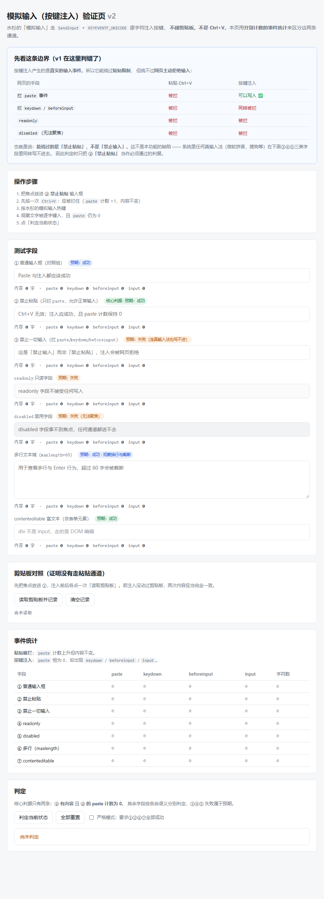

# 水杉输入法 · 自动输入分支 — 本地编译与安装

> ## 关于本仓库
>
> 本仓库是 **水杉输入法 Windows 端**的一个**修改版本**，原始作品来自
> [**metasequoiaime/msime-windows**](https://github.com/metasequoiaime/msime-windows)
> （官网 <https://msime.app>）。**原作的著作权归上游作者与贡献者所有**，本仓库的维护者不是原作者，
> 与上游项目方没有隶属关系，本仓库也不代表上游。
>
> 本仓库继续以 **GPL-3.0** 分发（`LICENSE` 为上游原件，未作修改），并按 GPL-3.0 § 5(a)
> **显著声明改动了原作的源文件及其日期** —— 完整的来源、修改清单与许可说明见
> [**FORK-NOTICE.md**](FORK-NOTICE.md)。
>
> 本仓库**不发布成品安装包、不做代码签名**；需要的用户请按下文自行编译。
> 如果需要签名版本，或希望功能进入上游，请走[上游项目](https://github.com/metasequoiaime/msime-windows)的渠道。

本仓库相对上游新增了**模拟输入（按键注入）**功能：按一个全局热键，把配置里的预置文本逐字符键入当前窗口。

## ⚠️ 先读这一段：为什么必须你自己编译

**本分支的安装包没有任何代码签名。**

这不是偷懒，而是有技术原因的：水杉的 Server 需要 `uiAccess="true"` 清单才能让候选窗浮在
高权限窗口之上，而 `uiAccess` **只在二进制拥有受信任的 Authenticode 签名时才生效**
（见 `server/AGENTS.md`）。没有受信任签名时，这个清单会让 Server 根本启动不起来。

所以本分支做了两件事：

1. **不注入 `uiAccess` 清单**，让 Server 能正常启动
2. **不发布成品安装包**，请你按下面的步骤在本机编译

由此带来两个你需要接受的限制：

| 限制 | 后果 |
|---|---|
| 没有签名 | 自己编译出来的东西不会有"未知发布者"问题（是本机产物），但如果装了自签名证书，SmartScreen 仍可能提示 |
| 没有 `uiAccess` | **模拟输入无法注入到"以管理员身份运行"的窗口**（普通窗口完全正常） |

---

## 一、准备工具链

全部装好大约需要 **30–60 分钟**（主要是下载与首次编译）。下表是实测通过的版本。

| 工具 | 版本要求 | 说明 |
|---|---|---|
| **Visual Studio 2026** | Community 即可，需勾选「使用 C++ 的桌面开发」 | 实测 MSVC **14.51.36231**、Windows SDK **10.0.26100.0**。**必须是 VS 2026**：工程用 `Visual Studio 18 2026` 生成器，且 CMake 需 ≥ 4.2 |
| **CMake** | ≥ 4.2（实测 4.4.4） | `cmake --version` |
| **vcpkg** | 最新即可 | 装好后设 `VCPKG_ROOT` 环境变量 |
| **Boost** | 1.93（实测） | **不能从 vcpkg 清单装** —— 见下面「Boost 怎么装」 |
| **Python** | 3.10+（实测 3.14.7） | 需要 `pypinyin`：`python -m pip install pypinyin` |
| **Node.js + pnpm** | Node 20+（实测 26.8.1）；pnpm 10.x | 设置页是 Vite/TypeScript 工程 |
| **Inno Setup** | **6.6 或更高**（实测 6.7.3） | 打安装包用；还需补中文语言文件，见下 |
| **GitHub CLI (`gh`)** | 最新（实测 2.102.0） | **用于拉词库**，`product_lock.py` 会调用它 |

### vcpkg

```powershell
git clone https://github.com/microsoft/vcpkg C:\Apps\vcpkg
C:\Apps\vcpkg\bootstrap-vcpkg.bat
# 设为用户级环境变量（新开终端生效）
[Environment]::SetEnvironmentVariable('VCPKG_ROOT','C:\Apps\vcpkg','User')
```

### Boost 怎么装（容易被卡住的一步）

Boost 是**静态链接但没写进 `server/vcpkg.json`**，所以不能用 manifest 模式装。而且 triplet
**必须是 `x64-windows-static-md`，不能是 `x64-windows-static`**：

- `Boost_USE_STATIC_LIBS ON` 要静态 Boost 库
- 项目其余部分用**动态 CRT**
- 用纯 static triplet 会把 Boost 也切到静态 CRT，链接时报 **LNK2038 RuntimeLibrary 不匹配**

用 vcpkg 装（最简单，CI 也是这么做的）：

```powershell
C:\Apps\vcpkg\vcpkg install boost-locale:x64-windows-static-md boost-json:x64-windows-static-md
# 之后设 BOOST_ROOT 指向它
[Environment]::SetEnvironmentVariable('BOOST_ROOT','C:\Apps\vcpkg\installed\x64-windows-static-md','User')
```

<details>
<summary>或者自己 bootstrap Boost（不想让 vcpkg 管 Boost 时）</summary>

```powershell
cd C:\Apps\Boost
.\bootstrap.bat
.\b2 -j8 address-model=64 architecture=x86 variant=release `
      link=static runtime-link=shared threading=multi `
      --with-locale --with-json
[Environment]::SetEnvironmentVariable('BOOST_ROOT','C:\Apps\Boost\stage','User')
```

注意 `runtime-link=shared`：这决定 Boost 用动态 CRT，与 `-static-md` 等价。
（Boost 的 git 仓库有大量 submodule，clone 后要先 `git submodule update --init --recursive`，
否则 `bootstrap.bat` 会以「不是内部或外部命令」失败。）
</details>

### Inno Setup 的中文语言文件

装完 Inno Setup 后，从**管理员** PowerShell 补中文语言文件：

```powershell
$env:Path += ';C:\Program Files (x86)\Inno Setup 6'   # 换成你的实际安装路径
.\scripts\ci\install-inno-language.ps1
```

不补的话编译安装包会报 `Couldn't open include file "...\Languages\ChineseSimplified.isl"`。

---

## 二、获取源码与词库

```powershell
git clone --recurse-submodules <你 fork 的仓库地址> msime-windows
cd msime-windows

# 若忘了 --recurse-submodules
git submodule update --init --recursive
```

> `vendor/opencc` 和 `vendor/cpp-pinyin` 是 submodule，**不拉会编译失败**。

### 词库（完整安装包需要）

词库不在仓库里，是由产品锁 `product-lock.json` 指定的 Release 资产。拉取：

```powershell
python scripts/product_lock.py fetch-dictionaries --staging-root .
```

它会下载到 **`MetasequoiaImeDict/`**（未跟踪目录，内含 `out/` 词库与 `source/` 源数据）。
下载后可以校验（注意传的是词库所在的 **`out`** 目录）：

```powershell
python scripts/product_lock.py verify-dictionaries MetasequoiaImeDict/out
```

**前置条件**：需要 `gh` 已登录（`gh auth login`）。没有 `gh` 会失败并报 `[WinError 2]`。

<details>
<summary>或者从同级仓 msime-dictionary 本地构建词库</summary>

```powershell
git clone <msime-dictionary 仓库> ..\msime-dictionary
python -m pip install pypinyin
python scripts/build-dictionary.py
```
</details>

### 语言模型（完整安装包需要）

```powershell
python scripts/build-language-model.ps1   # 用 powershell 执行
```

它会下 **~74 MB** 源数据并转换（缓存落在 `language-model/cache/`），最终产出
`language-model/sc.lm`（约 33 MB）。脚本幂等，摘要对得上就直接返回。

> **只想先跑通、不想下这些数据？** 走**轻量包**（第三节的「轻量路径」），跳过词库和语言模型，
> 装出来的输入法没有词库，但 **模拟输入功能完全可以验证**。

---

## 三、编译

先打开一个**新的** PowerShell（让 `VCPKG_ROOT` / `BOOST_ROOT` 生效），然后确认：

```powershell
$env:VCPKG_ROOT    # 应指向你的 vcpkg
$env:BOOST_ROOT    # 应指向 x64-windows-static-md 或 Boost\stage
```

### 3.1 编译 Server

```powershell
cmake -S server -B server/build-release -G "Visual Studio 18 2026" -A x64 `
  -DCMAKE_TOOLCHAIN_FILE="$env:VCPKG_ROOT/scripts/buildsystems/vcpkg.cmake" `
  -DVCPKG_TARGET_TRIPLET=x64-windows `
  -DBoost_ROOT="$env:BOOST_ROOT"

cmake --build server/build-release --config Release --target MetasequoiaImeServer --parallel
```

首次会通过 vcpkg 装一大批依赖，**大约 10–20 分钟**；之后是增量编译。

> 也可以用仓库自带的 `server\scripts\lcompile-release.ps1`（增量、自动 configure）。
> 它**不注入 `uiAccess` 清单**，构建出来的 Server 能直接跑。
>
> 背景：`uiAccess="true"` 只在二进制**拥有受信任签名**时才生效。本分支不签名，
> 所以本地构建与发布都不该带这个清单（发布路径由 `release.yml` 在测试之后单独注入）。
> 早期版本的这个脚本会无条件注入它，导致本地构建的 Server 启动失败 —— 已移除。

### 3.2 编译 TSF DLL（x64 与 x86 都要）

```powershell
# x64
cmake -S windows -B windows/build64-release -G "Visual Studio 18 2026" -A x64 `
  -DCMAKE_TOOLCHAIN_FILE="$env:VCPKG_ROOT/scripts/buildsystems/vcpkg.cmake" `
  -DVCPKG_TARGET_TRIPLET=x64-windows-static
cmake --build windows/build64-release --config Release --target MetasequoiaImeTsf --parallel

# x86（32 位应用需要）
cmake -S windows -B windows/build32-release -G "Visual Studio 18 2026" -A Win32 `
  -DCMAKE_TOOLCHAIN_FILE="$env:VCPKG_ROOT/scripts/buildsystems/vcpkg.cmake" `
  -DVCPKG_TARGET_TRIPLET=x86-windows-static
cmake --build windows/build32-release --config Release --target MetasequoiaImeTsf --parallel
```

> TSF 侧用 **静态 CRT**（`MultiThreaded`）+ `x64-windows-static` triplet；
> Server 侧用**动态 CRT** + `x64-windows`。**这两者不能合并到一个 build tree**，
> 所以是两个独立的 CMake 工程，这是有意设计。

### 3.3 构建设置页

```powershell
cd ui-html\webview2\settings\ime-settings
pnpm install --frozen-lockfile
pnpm build
cd ..\..\..\..
```

`pnpm build` = `prebuild`（契约一致性校验）→ `tsc` → `vite build`，一条命令即可。

> **关于 `prebuild` 里的 Python**：契约校验脚本原本是用 `python3` 直接调用的，
> 而 Windows 上 `python3` 通常解析到 Microsoft Store 的存根程序
> （`%LOCALAPPDATA%\Microsoft\WindowsApps\python3.exe`），它什么都不做就退出，
> 于是 `pnpm build` 会以 **9009** 失败。
>
> 现在这一步走 `scripts/sync-contracts.mjs`：它会依次尝试 `python` / `python3`，
> 取第一个**真能执行**的解释器（Store 存根会被跳过），失败时给出明确提示。
> 需要指定解释器时设环境变量 `MSIME_PYTHON`。
>
> 若确实没有 Python，也可以只跑 `pnpm exec tsc && pnpm exec vite build` 跳过校验
> （CI 仍会校验契约一致性）。

### 3.4 准备数据文件（完整包）

完整包需要**四类数据**，都要先备好，否则 `Prepare-PackageFiles.ps1` 会在断言处失败。
四个脚本都**幂等**，摘要对得上就直接返回，重复跑不会重下：

```powershell
# ① 词库（第二节已做，这里是复查）—— 唯一需要 gh 登录的一步
python scripts/product_lock.py fetch-dictionaries --staging-root .

# ② 词格整句语言模型 sc.lm（约 33 MB，首次要下 ~74 MB 语料再用 tar 解压转换）
powershell -File scripts\build-language-model.ps1

# ③ 神经整句模型（约 28 MB，curl 匿名下载，不需要 gh）
powershell -File scripts\download-neural-model.ps1

# ④ 拼音词典与辅助码：随仓库提供，无需下载
```

> ②③ 都是先写临时文件再改名，摘要不符不会留下坏文件。

> **轻量路径完全跳过本节。** 只想验证模拟输入功能的话，直接做 3.5 的轻量打包即可，
> 省掉约 1 GB 的数据与下载时间。

### 3.5 打包

```powershell
cd installer
.\Prepare-PackageFiles.ps1 -TargetVersion 0.7.1

# 用本机自签测试证书给包内 EXE/DLL 签名（可跳过，但跳过会让部分安防软件更啰嗦）
.\Sign-PackageBinaries-Local.ps1

# 用 Inno Setup 编译安装包
.\Compile-Installer.ps1 -IsccPath "C:\Program Files (x86)\Inno Setup 6\ISCC.exe"
```

> 各组件目录（`windows` / `server` / `ui-html` / `engine/helpcode` / `MetasequoiaImeDict` /
> `language-model`）都是 `Prepare-PackageFiles.ps1` 的**默认值**，按标准布局 clone 就不用传。

产物在 **`installer\Output\MetasequoiaIME_Setup_v0.7.1.f1.a1.exe`**。

**版本号说明**：

| 位置 | 值 | 约束 |
|---|---|---|
| `version.txt` | `0.7.1` | **必须三段 semver**，`apply_version.py` 会校验 |
| 安装包文件名 / 显示名 | `0.7.1.f1.a1` | `f1`=自动输入分支，`a1`=第 1 次发版（下次改 `a2`） |
| PE 版本资源 | `0.7.1.0` | 必须 4 段纯数字 |

改版本号只需动 `installer/msime_setup.iss` 里的 `#define MyForkTag ".f1.a1"` 一行。
（`MyAppVersion` 由 `Prepare-PackageFiles.ps1` 原地改写，**这是它的既有设计**；
它会把该文件改脏，用 `git checkout -- installer/msime_setup.iss` 还原即可。）

#### 轻量路径（只验证功能，省掉 1 GB+ 数据）

**仍然要完成 3.1–3.3 的编译**，只是**跳过 3.4 的数据准备**。
适合：只想验证模拟输入、或本机已装过完整版（词库已在数据目录里）时。

```powershell
cd installer
.\Prepare-PackageFiles.ps1 -TargetVersion 0.7.1 -Light
.\Compile-Installer.ps1 -IsccPath "C:\Program Files (x86)\Inno Setup 6\ISCC.exe"
```

轻量包不带词库、拼音表与出厂配置，产物名带 `_light` 后缀。

---

## 四、安装

```powershell
cd installer
.\Install.ps1                    # 完整包
.\Install.ps1 -Light             # 轻量包
```

或直接双击 `installer\Output\` 下生成的安装包。安装程序会：

1. 申请管理员权限（Inno Setup 运行时提权，会弹 UAC）
2. 把 TSF DLL 装到 `C:\Program Files\metasequoiaime\msime_v<版本>\`
3. 注册 TSF 文本服务，注册 `Metasequoia IME Watchdog` 计划任务
4. 把数据文件放到你选择的数据目录（默认 `%LOCALAPPDATA%\metasequoiaime`）

卸载：控制面板 → 程序和功能 → **Metasequoia IME**，或运行安装目录下的 `unins000.exe`。

---

## 五、验证功能

### 5.1 先确认 Server 在运行

任务管理器里应该有 **`MetasequoiaImeServer.exe`**。**如果没有，中文输入也会一起坏掉** ——
因为 TSF DLL 只是前端，真正的输入引擎在 Server 里。

排查：看 `C:\Program Files\metasequoiaime\server\` 下能否手动启动它。
若闪退，先确认这个 exe 的清单里**没有** `uiAccess="true"`：

```powershell
$mt = Get-ChildItem 'C:\Program Files (x86)\Windows Kits\10\bin\*\x64\mt.exe' |
      Select-Object -First 1 -ExpandProperty FullName
& $mt -nologo -inputresource:"C:\Program Files\metasequoiaime\server\MetasequoiaImeServer.exe;#1" `
      -out "$env:TEMP\srv.xml"
Select-String -Path "$env:TEMP\srv.xml" -Pattern 'requestedExecutionLevel'
```

若显示 `uiAccess="true"`，说明这个 exe 带了不该带的清单（只有签名发布版才应该带），
用 [3.1](#31-编译-server) 的命令重编 Server 即可。

### 5.2 配置模拟输入

打开设置 → **快捷键** 页 → 底部「**模拟输入（按键注入）**」区块：

| 项 | 说明 |
|---|---|
| 启用 | 总开关，默认关闭 |
| 触发热键 | **点击输入框后按下组合键**录制（至少要有一个修饰键 + 一个主键）。留空=不触发 |
| 预置文本 | 要自动键入的内容。**停止输入约 0.4 秒后自动保存**，失焦时也会立刻补保存 |
| 发送 Enter | 文本里的换行是否发真实 Enter |
| 字符间隔 | 每字符间隔毫秒数，0 = 全速 |

配置落在数据目录的 `config.toml`：

```toml
[autotype]
enabled = true
hotkey = "ctrl+alt+p"
text = "要输入的内容"
send_enter = true
char_delay_ms = 30
```

保存后 Server 最迟 **300 ms** 内会重新加载（有 Aux 管道通知 + 文件 mtime 轮询兜底）。

### 5.3 用测试页验证「绕过粘贴」

仓库根目录的 [`autotype-test.html`](autotype-test.html) 是专门为此写的自包含测试页
（双击即可打开，无需服务器）。它长这样：



操作步骤：

1. 用浏览器打开它
2. 焦点放进 **② 禁止粘贴** 输入框（该字段用 `preventDefault()` 拦掉了 `paste` 事件）
3. 先按 `Ctrl+V` → 被拦住，`paste` 计数 +1、内容不变
4. 按你配置的热键 → **文字应被逐字键入，且 `paste` 计数保持 0**
5. 点「判定当前状态」

**判定原理**：内容进来了、但 `paste` 计数为 0 → 说明走的是按键注入，不是剪贴板。

> 建议先点「全部重置」清空计数再测，这样能看到最干净的 `paste=0` 证据
> （`paste` 是累计值，之前那次 `Ctrl+V` 会留在里面）。

页面里各字段的预期结果：

| 字段 | 预期 | 原因 |
|---|---|---|
| ① 普通输入框 | ✅ 成功 | 对照组 |
| ② **禁止粘贴** | ✅ **成功** | 这是核心判据：绕过了 `paste` 拦截 |
| ③ 禁止一切输入 | ✅ 仍可写入 | `preventDefault()` 挡不住 Unicode 注入 |
| ④ `readonly` | ❌ 不写入 | 不可编辑元素，硬性拒绝 |
| ⑤ `disabled` | ❌ 不写入 | 无法获得焦点 |
| ⑥ 多行 | ✅ 成功 | 验证换行/Enter 行为 |
| ⑦ contenteditable | ✅ 成功 | 需先点进 div 让光标出现 |

> **能绕过的是「禁止粘贴」，不是「禁止输入」。** ④⑤ 这类字段里，系统里任何真输入法
> （微软拼音、搜狗等）同样写不进去 —— 它们走同一条输入路径。这不是本功能的缺陷。

---

## 六、常见问题

| 现象 | 原因与解法 |
|---|---|
| `bootstrap.bat 不是内部或外部命令` | Boost 仓库的 submodule 没拉。先 `git submodule update --init --recursive` |
| `LNK2038 RuntimeLibrary 不匹配` | Boost 用了 `x64-windows-static`。必须用 **`x64-windows-static-md`** |
| `LNK1181 找不到 WebView2Loader.dll.lib` | build 目录名不是 `build-release`。`server/CMakeLists.txt` 靠 `${CMAKE_BINARY_DIR}` 解析 vcpkg，且目录名是 `build` 以外才测得出来 |
| `Couldn't open include file "...ChineseSimplified.isl"` | 没跑 `scripts/ci/install-inno-language.ps1` |
| 编译过了，但装完 Server 不启动 / 中文输入全坏 | 该 exe 带了 `uiAccess="true"` 清单（只有签名发布版才该带）。按 [5.1](#51-先确认-server-在运行) 的 `mt.exe` 命令确认，然后用 [3.1](#31-编译-server) 重编 Server |
| `fetch-dictionaries` 报 `[WinError 2]` | 没装 `gh` 或没 `gh auth login` |
| `pnpm build` 提示找不到 Python 3 | 装 Python 3.10+ 并让 `python` 进 PATH，或设 `MSIME_PYTHON` 指向解释器；也可只跑 `pnpm exec tsc && pnpm exec vite build` |
| 热键按了没反应 | ① 确认 `config.toml` 里 `enabled=true` 且 `text` 非空；② 确认 Server 在跑；③ 预置文本改完等约 0.4 秒（或点一下别处）再按热键 |
| 能输入普通窗口、不能输入管理员窗口 | **预期行为**，无签名时 `uiAccess` 不生效 |

---

## 七、目录速查

| 路径 | 内容 |
|---|---|
| `server/` | 常驻后端（配置、词库、窗口、WebView2 宿主、IPC 服务） |
| `windows/` | TSF 文本服务 DLL（按键预判、焦点、edit session） |
| `engine/` | 输入引擎（会话、候选查询、辅助码、跨进程契约） |
| `ui/` | 通用 Win32 / Direct2D / DirectWrite 控件库 |
| `ui-html/` | 候选窗、工具栏、菜单、设置页的前端 |
| `installer/` | 收集产物、自签名、Inno Setup 打包 |
| `scripts/` | 构建与发布脚本 |
| `docs/fork-release.md` | 本分支的版本号方案与发行说明（维护者向） |
| `autotype-test.html` | 模拟输入验证页 |
